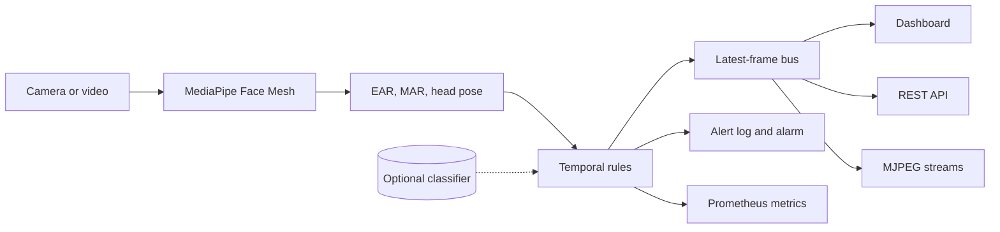

# Driver Surveillance System (DSS)

Real-time driver fatigue and attention monitoring from a single camera. DSS measures the eyes,
mouth and head on every frame, decides from how those signals change over time whether the driver
is fit to drive, and reports that through an operator dashboard, a REST API and Prometheus metrics.

> **Not a safety device.** DSS is an engineering project. Its thresholds are starting points that
> have not been validated in a vehicle or a clinical study. It must not be relied on to keep anyone
> safe.

## What it detects

A single frame cannot show drowsiness, because a blink looks exactly like a closed eye. Every rule
therefore depends on duration or rate.

| Signal | Rule (defaults) | Level |
|---|---|---|
| Prolonged eye closure | Eyes closed for 1.5 s without a break | Critical |
| Head dropping | Chin down 20° or more, held for 2 s | Critical |
| PERCLOS | Eyes closed for 15% or more of the last 60 s | Warning |
| Frequent yawning | 3 yawns of at least 1.5 s within 5 minutes | Warning |
| Looking away | Head turned 30° or more, held for 2 s | Warning |
| Head tilted | Head rolled 25° or more, held for 2 s | Warning |
| Driver not visible | No face found for 2 s | Warning |
| Classifier (optional) | Trained model's smoothed score of 0.7 or more | Warning |

Head angles are measured against each driver's neutral position, learned in the first 5 seconds,
so an off-centre camera does not read as a driver looking away.

## How it works



See [docs/architecture.md](docs/architecture.md) for the design and the reasons behind it.

## Quick start

DSS needs **Python 3.10, 3.11 or 3.12**, because MediaPipe has no builds for newer versions.

```bash
git clone https://github.com/rahulmandal0207/DSS_backend.git
cd DSS_backend
python -m venv .venv
```

Activate the environment with `.venv\Scripts\activate` on Windows or `source .venv/bin/activate`
on Linux and macOS, then install and run:

```bash
pip install -r requirements.txt
pip install --no-deps .
dss serve
```

Open <http://127.0.0.1:8000> for the dashboard. Without a webcam, point DSS at a video:

```bash
DSS_VIDEO_SOURCE=drive.mp4 DSS_VIDEO_LOOP=true dss serve
```

On Windows PowerShell, set the variables first with `$env:DSS_VIDEO_SOURCE = "drive.mp4"`, or put
them in a `.env` file. [.env.example](.env.example) lists the common ones.

## Commands

| Command | Purpose |
|---|---|
| `dss serve` | Run the dashboard and API |
| `dss monitor` | Run with a local preview window (press `q` to quit) |
| `dss extract --input <dir> --output <csv>` | Build training data from labelled images |
| `dss train --data <csv> --output <model>` | Train the optional classifier |

## API

| Endpoint | Purpose |
|---|---|
| `GET /` | Operator dashboard |
| `GET /api/v1/status` | Current driver state and measurements |
| `GET /api/v1/alerts` | Recent alert changes |
| `GET /api/v1/streams/<view>` | Live MJPEG video: `original`, `annotated`, `eye_closure`, `yawn`, `head_tilt` |
| `GET /api/v1/health` | Liveness probe (no authentication) |
| `GET /api/v1/ready` | Readiness probe (no authentication) |
| `GET /metrics` | Prometheus metrics |

The original `/video_feed/<view>` URLs still work. Full details, with response examples, are in
[docs/api.md](docs/api.md).

## Security and privacy

- Binds to `127.0.0.1` by default, and refuses to start on a network address without `DSS_API_KEY`.
- CORS is closed unless you list origins in `DSS_CORS_ORIGINS`.
- Frames stay in memory and are never written to disk. Set `DSS_STREAM_ENABLED=false` to run on
  measurements alone, with no video leaving the process.

See [docs/operations.md](docs/operations.md) for deployment and the full configuration reference,
and [SECURITY.md](SECURITY.md) for reporting a vulnerability.

## Docker

```bash
DSS_API_KEY=change-me docker compose up --build
```

Passing a webcam into a container needs a Linux host. On Docker Desktop for Windows or macOS, use a
video URL instead, as described in [docs/operations.md](docs/operations.md#docker).

## Project layout

```text
src/dss/
├── config.py       Typed settings from the environment
├── domain.py       Value objects shared by every layer
├── cli.py          The dss command
├── vision/         Landmarks, EAR and MAR, head pose, video overlays
├── detection/      The frame pipeline and temporal rules
├── ml/             Dataset extraction, training and inference
└── service/        Capture loop, alerts, HTTP API and dashboard
tests/              Unit, service and real-MediaPipe integration tests
docs/               Architecture, API, operations and model guides
```

## Development

```bash
pip install -r requirements-dev.txt
pip install --no-deps -e .
pytest --cov=dss
ruff check src tests
ruff format --check src tests
mypy
```

See [CONTRIBUTING.md](CONTRIBUTING.md).

## Limitations

- Thresholds are defaults from the published literature and practice, not values tuned on a
  validated dataset, and no accuracy is claimed. A trained model reports its own scores in the
  metrics file that `dss train` writes.
- Head pose from a generic face mesh is good enough for thresholds, not for precise angles.
- Sunglasses, low light and steep camera angles reduce landmark quality. There is no infrared
  support, so night driving is untested.
- MediaPipe's Face Mesh is pinned to `0.10.21`. Moving to its newer task API would be a migration.
