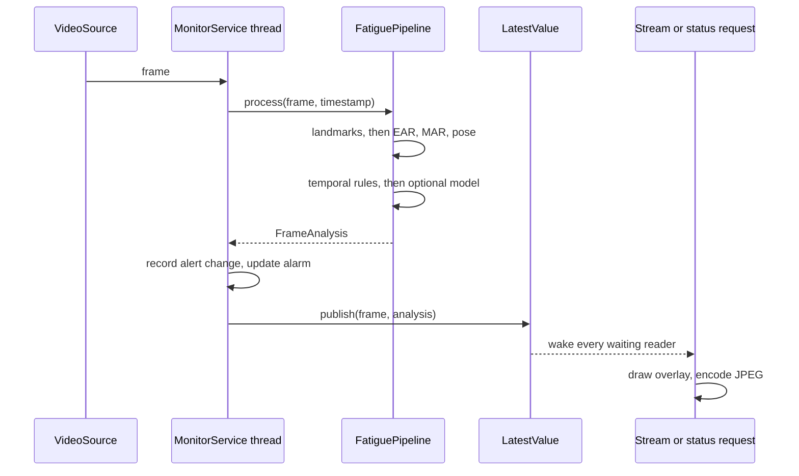

# Architecture

## Layers

Dependencies point one way. Nothing in `vision` or `detection` knows about HTTP, and nothing in
`service/api.py` knows how fatigue is decided.

| Layer | Responsibility | Depends on |
|---|---|---|
| `domain.py` | Value objects: metrics, assessments, alert levels | nothing |
| `config.py` | Validated settings from the environment | nothing |
| `vision/` | Pixels to measurements, and measurements back to overlays | `domain` |
| `ml/` | Dataset extraction, training, inference | `domain`, `vision` |
| `detection/` | Measurements over time to a decision | `vision`, `ml`, `domain`, `config` |
| `service/` | Threads, camera, alerts, HTTP | everything above |

## One frame through the system

## Design decisions

### Measurements use pixels, not normalised coordinates

MediaPipe divides x by the frame width and y by the frame height, so a ratio computed from those
numbers is multiplied by the aspect ratio. The same eye would read 78% higher at 16:9 than in a
square frame, and a threshold tuned on one camera would mean something different on another.
`MediaPipeFaceMesh` therefore converts to pixels at the boundary, and everything after it works in
pixels.

### Decisions come from time, not frames

`detection/temporal.py` measures every window in seconds, and PERCLOS is weighted by time, because
frame rate varies with lighting and CPU load. A frame-counted rule would become stricter whenever
the machine slowed down.

Time with no visible face is excluded from PERCLOS rather than counted as eyes open, so the driver
looking down at a phone cannot lower their own score.

### Both eyes are averaged

Requiring the mean of both eyes to fall below the threshold means a wink, or one eye hidden by a
turned head, does not count as closure.

### Head pose comes from the mesh's own axes

MediaPipe predicts depth for every landmark, so the line across the eyes and the line from forehead
to chin give the face's orientation directly. `cv2.solvePnP` with a generic 3D face was tried first
and rejected: it read a nearly frontal photograph as pitched by about 30 degrees, against about 10
this way. Reading the mesh needs no face model or camera calibration, and has no solver to diverge.

A per-driver baseline, learned in the first few seconds, removes what remains of the camera angle
and mesh bias.

### One writer, a latest-value bus, and any number of readers

`MonitorService` owns the camera and is the only thread that touches MediaPipe. It publishes to
`LatestValue`, which keeps only the newest result and wakes every reader.

A queue would be the wrong structure. Consumers would compete for items, so two open streams would
each get about half the frames, and a slow client would fall behind live. On a safety feed the only
frame worth having is the latest one. Overlays and JPEG encoding happen on each reader's own thread,
so a slow client cannot delay detection.

### Failure is contained

| Failure | Behaviour |
|---|---|
| Camera missing or unplugged | Retried indefinitely; `/ready` reports 503, `/health` stays 200 |
| Camera connected but frozen | `camera_frozen` warning, other rules paused; `/ready` reports 503 |
| Exception on one frame | Frame dropped and counted in `dss_frame_errors_total` |
| No audio device | One warning logged; monitoring continues |
| Too many video viewers | 503 with `Retry-After`, keeping threads free for status and health |

### A frozen picture is treated as a fault

A camera can stay connected and keep delivering frames while its picture has stopped: a virtual
camera showing a placeholder, or a driver or backend that has stalled. Nothing fails, so a frozen
picture of an alert driver would read as "normal" indefinitely, which is the worst way for a
monitor to fail.

`FreezeDetector` compares a sparse grid of pixels between frames. Real sensors always produce
noise, so a live picture never repeats exactly, even with nothing moving in view. On one laptop
webcam the smallest change seen between frames was 3.2 out of 255 with the user sitting still,
against exactly 0 on a still feed, so the default threshold of 0.05 sits well clear of both.

While the picture is frozen, every other rule sees "no measurement". A stale picture says nothing
about the driver, so a feed that stalls mid-blink must not raise a closed-eyes alarm.

### The classifier can only add caution

Rules are explainable and need no training data, so they are the primary decision. The optional
model can raise a warning, smoothed over a few seconds, but can never clear an alert a rule raised.
A confused model therefore costs a false alarm, not a missed one.

## Threads

| Thread | Work |
|---|---|
| `dss-monitor` | Capture, analysis, publishing, alert log |
| `dss-alarm` | Audio playback, only with `DSS_SOUND_ENABLED` |
| Waitress workers | HTTP. Each open video stream holds one until the client disconnects |

`server_threads - 2` workers can stream at once. The two kept back serve status and health checks.
